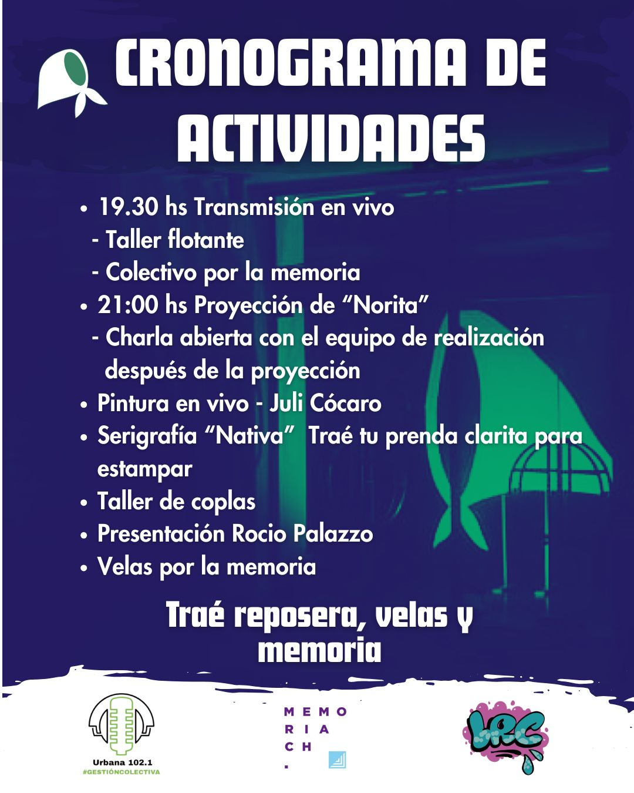

# 

# Música y coplas en la vigilia por los 50 años del golpe en la [radio FM Urbana 102.1](https://www.instagram.com/fmurbana1021/)

---

# Rocio Palazzo, Nicolás Benaghi e Ignacio Viano







---

# Coplas



[Streaming en formato WAV](https://pixeldrain.com/u/BTcBxvG7)

[Artículo en Internet Archive](https://archive.org/details/live-2026-03-24-movilizacin-por-la-memoria-verdad-y-justicia)
