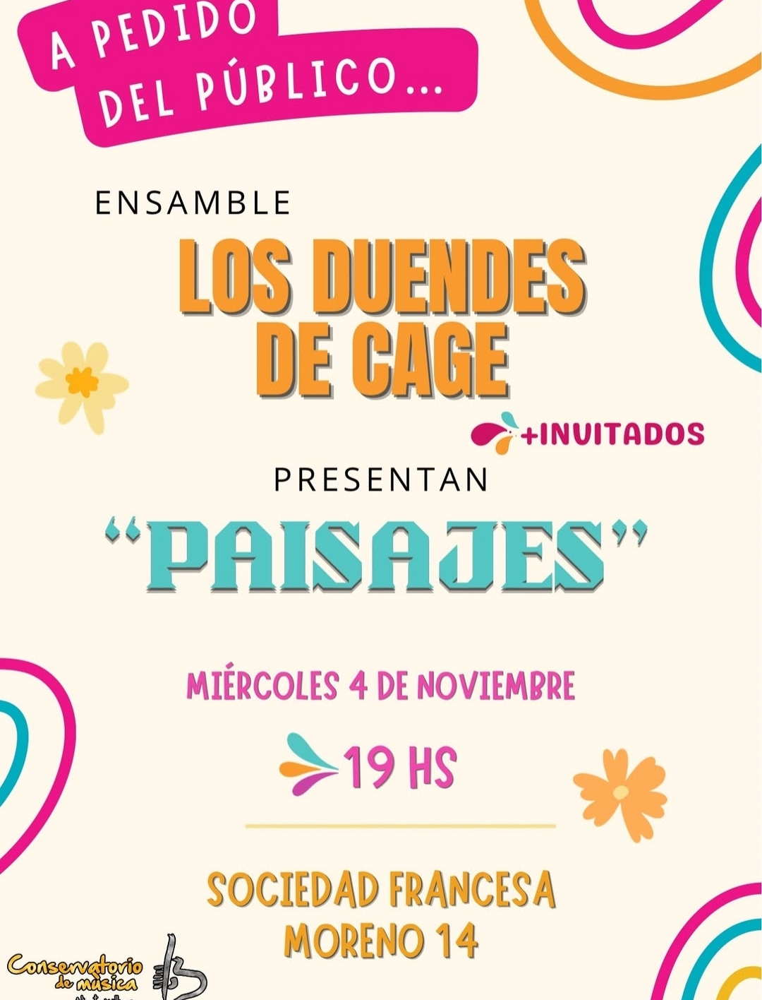

# [Los Duendes de Cage](https://www.instagram.com/duendesdecage/) en la [Sociedad Francesa de Chivilcoy](https://www.instagram.com/sociedadfrancesa.chivilcoy/).
# Treinta y dos artistas en escena, treinta y dos motivos para seguir defendiendo la educación pública, gratuita y de calidad. Gracias al [Conservatorio Alberto Williams](https://www.instagram.com/conser_chivilcoy/) por hacer posible este momento.

## Artistas que participaron:
## Valentino Amato
## Ludmila Salto
## Abigail Juarez Villafañe
## Juana Villalba
## Micaela Tripulillo
## Raquel Fernandez
## Roque Andisco
## Romina Calderon
## Joaquin Gardella
## Clemente Diez
## Nicolas Muchiut
## Carla Tomassini
## Sofia Banchero
## Ana Cieli
## Pedro Fernandez
## Nahuel Coire
## Candela Banchero
## Augusto Canoves
## Marcos Larrañaga
## Luciano Sarratea
## Agustin Urga
## Juan Papavero
## David Giuliano
## Leonardo Banchero
## Nicolas Gomez
## Jose Luis Clavio
## Lena Borsarelli
## Carolina Cuellas
## Celeste Echazarreta
## Tito Cuellas
## Paloma Palumbo
## Pablo Torres

---

# Paisajes Bloque 1



---

# Paisajes Bloque 2



---

## [Artículo en Internet Archive](https://archive.org/details/live-2026-11-03-duendes-de-cage-paisajes-en-la-sociedad-francesa-de-chivilcoy)
